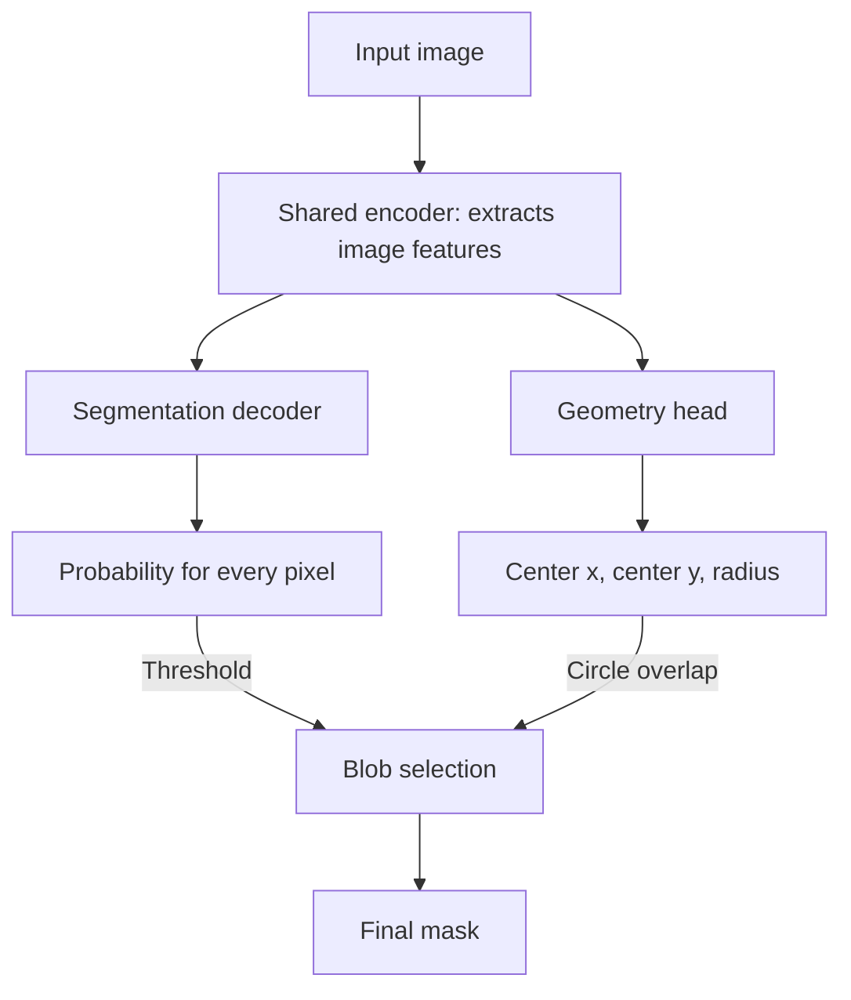

# Project Overview

## What This Repo Is

This repository packages a mouse pupil segmentation, pupil-diameter, and opt-in pupil-center velocity analysis pipeline. It can extract sampled or consecutive full-frame images from video, run a trained attention UNet on centered eye images, and save pupil size, tracking, quality-control, and optional mask-overlay outputs.

The distribution and repository are `mouse-pupil-analysis`; the only Python
package is `mouse_pupil_analysis`. The user-facing command line tools are
`run-pupil-analysis` and `extract-frames`, both declared in `pyproject.toml`.
This project ships no `pupil_tracking` module: that import path is owned by an
unrelated PyPI distribution and must not be claimed here.

## Active Runtime Path

### 1. `pyproject.toml`

- Declares the `mouse-pupil-analysis` distribution, Python `>=3.10`, runtime dependencies, dev tools, package data, and console scripts.
- The console scripts are:
  - `extract-frames = mouse_pupil_analysis.extract_frames:main`
  - `run-pupil-analysis = mouse_pupil_analysis.run_pupil_analysis:main`
- Package data includes checkpoint weights (`*.pth`), training logs (`*.txt`), and calibrated-threshold metadata (`*.json`); archive checkpoints are excluded.

### 2. `mouse_pupil_analysis/pupil_predictions.py`

- Owns packaged-checkpoint selection, calibrated-threshold resolution, PNG frame discovery, UNet inference, pupil-diameter calculation, and confidence-heatmap overlays; it has no acquisition-time dependency.
- Streams one transient `PupilPrediction` at a time so diameter, tracking, and overlay consumers share one model pass without retaining all float probability maps.
- Exposes reusable `generate_pupil_predictions(...)` and `generate_pupil_mask_prediction(...)` functions without depending on the analysis CLI.
- Includes an editable `if __name__ == "__main__":` block for direct runs with hardcoded local paths and inference settings.
- The packaged default is `615pupils_thresh=0.525_iou=0.6088.pth`, the full
  two-head all-615 refit trained with center/radius supervision.
  Calibration selects threshold 0.525. The filename score summarizes the four
  CV folds used to select the recipe.
- Accepts full two-head checkpoints as well as legacy mask exports. By default,
  two-head inference keeps all whole blobs with
  at least 20% of their area inside the predicted circle;
  `show_all_heads` only changes overlays to show all segmentation confidence
  colors, the geometry circle, and a dashed contour of the retained mask.
  `prefer_geometry_component=False` explicitly disables
  geometry selection for raw-head inspection. `geometry_head_only=True` (CLI
  `--geometry-head-only`) draws just the learned circle and center in overlays;
  the analysis measurements still use the final segmentation. The reusable
  model and selector live in `mouse_pupil_analysis/geometry.py`; training retains
  compatibility imports. Published v0.4.0 accidentally contained a mask-only
  export; the correction is on dev pending a new release.

### 3. `mouse_pupil_analysis/api.py`

- Owns pipeline orchestration, independent of any command line.
- `AnalysisConfig` collects every input and validates combinations in one place; `run_analysis(config)` returns an `AnalysisResult` carrying the analysis table, both output paths, the resolved prediction threshold, frame metadata, and internal segmentation/tracking DataFrames.
- `analyze_video(...)` and `analyze_frames(...)` are keyword wrappers intended for notebook and script use.
- If a video is provided, calls `extract_selected_frames(...)` before inference.
- Composes the streaming inference iterator with always-on segmentation QC plus optional temporal tracking and overlays.
- With `calculate_velocity`, analyzes consecutive source frames using an explicit acquisition timebase and appends accepted center, speed, and three-state quality fields/panels to the unified outputs.

### 4. `mouse_pupil_analysis/run_pupil_analysis.py`

- Implements the `run-pupil-analysis` CLI: it parses arguments, builds an `AnalysisConfig`, and reports validation failures through `parser.error(...)` so usage mistakes print usage text rather than a traceback. Running the source file with no arguments instead uses its editable direct-run configuration block.
- Accepts either `--video_path` or `--image_dir`.
- The deprecated `--prefer_central_component` flag warns and retains its legacy
  fixed-image-center behavior; this branch's two-head inference uses circle overlap.
- Enables console logging so terminal output matches the historical `print`-based behavior.

### 5. `mouse_pupil_analysis/results.py` and `mouse_pupil_analysis/plotting.py`

- `results.py` builds the compact user-facing table, including visibility and three-state segmentation QC for every run, and writes the CSV and figure. `DIAMETER_COLUMNS` and `VELOCITY_COLUMNS` are the authoritative output schemas.
- `plotting.py` returns Matplotlib figures rather than saving them, so the standard panels can be restyled or embedded elsewhere.

### 6. `mouse_pupil_analysis/extract_frames.py`

- Implements the frame-extraction CLI and reusable `extract_selected_frames(...)`.
- Samples evenly spaced frames from the input video with OpenCV.
- Can extract consecutive source frames and return source-frame metadata for velocity analysis.
- Honors `--extraction_fps` and `--max_frames`, reducing effective extraction FPS when needed.

### 7. `mouse_pupil_analysis/tracking.py`

- Postprocesses UNet probability maps without changing the model or checkpoint.
- `SegmentationAccumulator` consumes every transient prediction and exposes visibility/QC without requiring velocity mode. `TrackingAccumulator` extends it with temporal processing when velocity is enabled.
- Selects and measures pupil components, maps centers back to original-image pixels, applies explainable quality flags, and calculates frame-to-frame displacement and velocity.
- Leaves published centers and velocities missing across rejected or non-consecutive frames rather than interpolating.
- Includes an editable `if __name__ == "__main__":` block for direct inspection of the detailed tracking DataFrame.

### 8. `mouse_pupil_analysis/preprocessing.py` and `mouse_pupil_analysis/augmentation.py`

- `preprocessing.py` owns `resize_with_pad`, `MODEL_IMAGE_SIZE`, and `InferenceDataset`. The 148 x 148 centered/padded convention defined here is load-bearing for the current trained model.
- `augmentation.py` owns the training-only augmentations and `SegmentationDataset`; nothing in it runs during inference.
- `dataset.py` remains only as a deprecated re-export shim. Its `PupilDataset` returned either `(image, name)` or `(image, mask)` depending on construction; the two dataset classes replace that.

### 9. `mouse_pupil_analysis/unet.py`

- Defines the segmentation model used by inference and training.

### 10. `mouse_pupil_analysis/logging_utils.py`

- Library modules log and never print, so an embedding application controls its own output. The console scripts call `configure_cli_logging()` to restore plain terminal output.

### 11. `training/`

- Contains the training launcher, fold manager, Labelme JSON conversion, and augmentation inspection.
- `training/README.md` documents data preparation, fresh training, checkpoint-based fine-tuning, and intentional checkpoint packaging.
- `training/run_train.py` is the short command-line and direct-run entry point; private
  `training/_trainer.py` owns training, evaluation, and run-artifact implementation.
- The trainer supports fresh training or lower-rate weight fine-tuning. A manifest validation holdout drives checkpoint selection and threshold calibration; normal training requires one. An all-labeled recipe instead trains every valid pair with fixed settings. `training/review_folds.py` renders the automatic session grouping, its pupil-size/lighting summaries, and validates manual whole-session reassignment.

### 12. `media/`

- Contains the tracked README animation and `media/make_gif.py`, the utility that regenerates it from local analysis results and overlays.
- `media/README.md` documents the required analysis outputs, animation controls, and promotion review.
- The GIF is a deliberately promoted documentation asset; other generated videos and candidate media remain local.

### 10. `sample_data/`

- Contains a public clone-and-run fixture: 32 labeled image/mask pairs from 10 sessions, six full-size unlabeled frames, and 31 consecutive prepared velocity frames.
- `sample_data/README.md` contains fixture-specific commands and links to the main analysis and training guides; `provenance.csv` records source and transformation details.
- The fixture is maintained example data rather than a benchmark. Its velocity sequence preserves source frames `07212`-`07242` at 97 Hz.
- `MANIFEST.in` includes the fixture and its training utilities in source distributions so the bundled guide and integrity test remain self-contained; wheels exclude them from the installed runtime package.

## Model Architecture Overview

The model predicts a mask of the visible pupil. In practice, on challenging
frames where contrast, lighting, or whiskers make the pupil appear fragmented,
we observed that the predicted mask can contain detached false regions.
We therefore extended the U-Net to also predict the pupil's center and radius.
This adds geometry supervision during training and provides a predicted circle
for selecting whole blobs from the segmentation output at inference. The
default selector uses a 20% area-overlap rule with unchanged
weights and training loss.

The model produces these outputs through two branches, called **heads**, that
share one encoder. Sharing the encoder lets both tasks use the same learned
image features without duplicating the main network. The geometry head reads
those features directly; it does not consume the predicted segmentation.



The input is a grayscale image resized and padded to 148 x 148 pixels. The
**shared encoder** learns features describing the eye, which feed both heads:

- **Segmentation head:** the decoder upsamples the features and combines them
  with finer features from earlier encoder layers through skip connections.
  It produces a pixel mask prediction; inference converts its logits to
  probabilities and thresholds them into candidate blobs.
- **Geometry head:** a separate branch compresses the shared bottleneck features
  into three numbers: center **x**, center **y**, and **radius**, expressed in
  model-image pixels. It does not derive these numbers from the predicted mask.

During training, both the segmentation loss and the center/radius regression
loss send error signals back into the shared encoder. Geometry supervision can
therefore influence the features used for segmentation as well as train its own
head.

The heads are modular because each branch has its own layers and weights. A
mask-only export can still produce segmentation using the shared encoder and
decoder. Predicting geometry requires retaining the geometry branch's weights
alongside that encoder.

**Final blob selection is postprocessing code after the neural network.** For
full two-head checkpoints, inference keeps every
8-connected blob with at least 20% of its pixels inside the predicted circle.
It uses both center and radius without circle expansion, extra confidence
ranking, or clipping accepted blobs. A single blob is also checked; if none
qualify the result is empty. Diameter uses the total retained area. QC and
tracking measure the union and its probability-weighted center, while largest-blob
dominance still flags fragmentation. Legacy/raw modes retain largest-component
QC. This rule does not guarantee correct pupil identification.
`--raw-segmentation` bypasses geometry selection for independent inspection.
The old confidence/area/center selector remains available for comparisons.
Geometry training still ignores empty masks; zero-radius supervision is a
separate proposed experiment, not part of this branch's initial comparison.

Implementation: [`unet.py`](mouse_pupil_analysis/unet.py) defines the encoder and
segmentation decoder; [`geometry.py`](mouse_pupil_analysis/geometry.py) adds the
geometry head and component selector. [`pupil_predictions.py`](mouse_pupil_analysis/pupil_predictions.py)
connects the predictions to thresholding and final-mask measurement.

## Segmentation-To-Velocity Method

Velocity mode is postprocessing around the existing pupil-segmentation model; it does not alter the UNet or its checkpoint.

1. **Preserve the timebase.** The pipeline analyzes consecutive source frames and assigns each frame a timestamp from its source-frame index and the actual acquisition rate.
2. **Prepare the model image.** Each grayscale frame is resized with its aspect ratio preserved, padded to the model's 148 x 148 input size, and passed through the attention UNet.
3. **Create the pupil segmentation.** A sigmoid converts model output to per-pixel probabilities. Unless `--pred_thresh` overrides it, inference uses calibration metadata beside the checkpoint, then a threshold encoded in its filename, and finally `0.7` for an uncalibrated custom checkpoint.
4. **Select and center the pupil candidate.** This branch's geometry selector keeps all blobs passing the 20% circle-overlap test and measures their union; raw and legacy modes measure the largest component. The center is the probability-weighted centroid of measured pixels, so higher-confidence pixels contribute more strongly. The resize and padding are then inverted to report the center in original-frame pixels.
5. **Apply per-frame quality control.** Empty masks are rejected. The measured mask is rejected if its mean probability is below `0.90`, its circularity is below `0.45`, or it touches the model-image border. If the largest component contains less than 80% of all foreground pixels, `low_component_dominance` is recorded as a warning but does not by itself reject the frame. These flags do not remove pixels from the final diameter mask or its dashed contour.
6. **Apply temporal area control.** Initially valid components are compared with the median component area within approximately +/-0.5 seconds. With at least four valid neighbors, an area below `0.65` or above `2.0` times that median is recorded as an `abrupt_area_change` warning while the center remains usable.
7. **Calculate motion without bridging gaps.** Published center coordinates are retained for usable `valid` and `warning` frames. For consecutive usable frame pairs, the pipeline calculates horizontal and vertical displacement, divides each by the actual elapsed time to obtain x/y velocity, and reports scalar speed as `sqrt(velocity_x^2 + velocity_y^2)`. It does not interpolate across rejected or missing frames.
8. **Preserve diagnostic evidence.** Every run retains an internal segmentation table and exposes visibility, a valid/warning/invalid status, and a concise reason in the compact CSV. Velocity mode adds the internal temporal table plus usable centers and speed. The unified plot supports frame-indexed review. Optional overlays map threshold-passing pixel probabilities from yellow just above the prediction threshold, through orange, to red near probability 1.0; thin center markers locate accepted and rejected candidates.

## Repo Structure Map

```text
mouse-pupil-analysis/
|- mouse_pupil_analysis/
|  |- __init__.py            (public API, lazily imported)
|  |- api.py                 (AnalysisConfig, run_analysis, analyze_video/frames)
|  |- run_pupil_analysis.py  (CLI only)
|  |- pupil_predictions.py
|  |- extract_frames.py
|  |- tracking.py
|  |- results.py
|  |- plotting.py
|  |- preprocessing.py
|  |- augmentation.py
|  |- dataset.py             (deprecated shim)
|  |- logging_utils.py
|  |- unet.py
|  |- checkpoints/
|- tests/
|  |- test_imports.py
|  |- test_cli_help.py
|  |- test_extract_frames.py
|  |- test_outputs.py
|  |- test_tracking.py
|  |- test_end_to_end.py
|  |- test_sample_data.py
|- training/
|  |- README.md
|  |- run_train.py
|  |- run_cross_validation.py
|  |- prepare_splits.py
|  |- review_folds.py
|  |- fold_manager.html
|  |- _trainer.py            (private training implementation)
|  |- _frame_scoring.py      (private recommender implementation)
|  |- provenance.py
|  |- data_collection.md
|  |- labelme_json2png.py
|  |- preview_augmentation.py
|- media/
|  |- README.md
|  |- make_gif.py
|  |- pupil_diameter_analysis_result_demo.gif
|- sample_data/
|  |- README.md
|  |- provenance.csv
|  |- training_data_split.json
|  |- labeled_frames/
|  |  |- <session>/
|  |     |- images/
|  |     |- masks/
|  |- unlabeled_frames/
|  |- velocity_frames/
|- labeled_frames/            (local, gitignored)
|  |- <session>/
|     |- images/
|     |- masks/
|     |- uncertain/          (optional; excluded from segmentation training)
|- training_data_split.json
|- folds/                   (generated, gitignored)
|- .github/workflows/ci.yml
|- pyproject.toml
|- README.md
|- AGENTS.md
|- project_overview.md
|- treaty_docs/next_steps.md
|- treaty_docs/work_log.md
|- treaty_docs/work_log_archive/
```

## Maintained vs. Local/Generated

Active, package-facing files:

- `mouse_pupil_analysis/__init__.py`
- `mouse_pupil_analysis/api.py`
- `mouse_pupil_analysis/run_pupil_analysis.py`
- `mouse_pupil_analysis/pupil_predictions.py`
- `mouse_pupil_analysis/extract_frames.py`
- `mouse_pupil_analysis/tracking.py`
- `mouse_pupil_analysis/results.py`
- `mouse_pupil_analysis/plotting.py`
- `mouse_pupil_analysis/preprocessing.py`
- `mouse_pupil_analysis/augmentation.py`
- `mouse_pupil_analysis/logging_utils.py`
- `mouse_pupil_analysis/unet.py`
- `mouse_pupil_analysis/checkpoints/`
- `tests/`
- `.github/workflows/ci.yml`
- `pyproject.toml`
- `README.md`
- `sample_data/`

Active local/developer scripts:

- `training/run_train.py`
- `training/run_cross_validation.py`
- `training/prepare_splits.py`
- `training/review_folds.py`
- `training/labelme_json2png.py`
- `training/preview_augmentation.py`
- `media/make_gif.py`
- `scripts/verify_distribution_namespaces.py` verifies that built distributions contain only the
  `mouse_pupil_analysis` package namespace; CI and the release workflow run it before wheel smoke
  tests or publication.

Local/generated surfaces to treat carefully:

- `images_test_*`, `images_*_result`, `predicted_masks_*`, `predictions_test/`, and `results/` are local analysis outputs.
- Root `labeled_frames/` holds the local labeled pool, one directory per recording session,
  each with `images/` and `masks/`; an optional `uncertain/` archive is deliberately ignored
  by segmentation training. It is gitignored, as is the derived `folds/`.
  `training_data_split.json`
  records the grouped, stratified fold assignment and *is* committed, so it is the only part
  of the fold-assignment record that survives a fresh clone. The `sample_data/` versions of both are
  intentionally tracked fixtures.
- `checkpoints_exp/` holds experimental training checkpoints.
- `videos/` holds local source recordings used for frame extraction, so this folder remains
  source-only. Recommender outputs and retained labeling queues live under `frames_to_label/`,
  with `extracted_frames/` and `recommended/` inside each session.
- `media/readme_demo/` holds only the local CSV and 90 overlays that exactly reproduce the
  tracked README GIF. Historical candidates and full-video review outputs are not maintained inputs.
- `build/`, `dist/`, `*.egg-info`, `__pycache__/`, `.pytest_cache/`, and `.ruff_cache/` are generated.
- `archive/` and `sketch*.py` style files are not the active package path.
- `mouse_pupil_analysis/checkpoints/archive/` contains historical checkpoint files excluded from package data.

## Authored vs. Derived

### Authored - hand-edit these

- Package Python modules, training/media utilities, sample fixtures, tests, `pyproject.toml`, `MANIFEST.in`, and CI configuration are maintained source.
- `README.md`, `AGENTS.md`, `project_overview.md`, `treaty_docs/next_steps.md`, and `treaty_docs/work_log.md` are maintained documentation. `treaty_docs/treaty_conventions.md` is the exception: it is upstream-managed through `treaty update`.
- The selection and packaging policy under `mouse_pupil_analysis/checkpoints/` is curated deliberately even though model binaries originate from training.

### Derived - regenerate or intentionally promote

- `build/`, `dist/`, `*.egg-info`, Python/tool caches, and local analysis/result folders are generated and should not be edited or staged.
- `checkpoints_exp/` is produced by `training/run_train.py`; package a selected model into `mouse_pupil_analysis/checkpoints/` only as an intentional, reviewed release change.
- `media/pupil_diameter_analysis_result_demo.gif` is generated by `media/make_gif.py` but intentionally tracked as the README's promoted demo asset.
- `sample_data/velocity_frames/` contains generated 148 x 148 grayscale resize-and-pad outputs, intentionally tracked as a compact temporal fixture.
- Local training images, masks, extracted frames, predictions, and plots are data or outputs, not repository source. The small curated files under `sample_data/` are the intentional exception.

## Tests And Fixtures

The test suite is intentionally lightweight:

- `tests/test_imports.py` imports the package.
- `tests/test_cli_help.py` runs `run-pupil-analysis --help`.
- `tests/test_extract_frames.py` verifies sampled/full-frame source-index selection.
- `tests/test_outputs.py` verifies 1-based source-frame naming, compact unified schemas, three-state tracking status, and plot creation.
- `tests/test_tracking.py` verifies coordinate mapping, component measurements, quality flags, timing, and kinematics with synthetic inputs.
- `tests/test_end_to_end.py` runs the real pipeline against the packaged checkpoint on a synthetic video generated in a fixture: extraction, the UNet forward pass, diameter and velocity outputs, overlays, and video-versus-image-directory agreement. Synthetic input verifies wiring rather than segmentation accuracy.
- `tests/test_sample_data.py` verifies paired sample counts, matching masks, full-size frame dimensions, the consecutive 31-frame velocity contract, and provenance coverage.
- `tests/test_real_images.py` runs the packaged checkpoint over the committed `sample_data/` frames, which is what actually detects a corrupted checkpoint or a preprocessing regression.
- `.github/workflows/ci.yml` runs Ruff, Black, Pytest, and a wheel smoke check across Python 3.10, 3.11, and 3.12 where appropriate.

`sample_data/` is the canonical portable fixture for manual end-to-end exploration. It deliberately avoids a video binary: uncropped PNGs exercise normal inference, while a short consecutive PNG sequence exercises temporal tracking with an explicit acquisition rate.

## User Data Expectations

The model expects the eye/pupil region to be centered enough that the majority of the eye appears in a 148 x 148 pixel area in the center of each frame. This matters because the trained model uses the current 148 x 148 padded image convention.

Primary input modes:

- `--video_path`: video file accepted by OpenCV; frames are extracted before inference.
- `--image_dir`: folder of PNG frames; extraction is skipped.

Primary outputs:

- `*_pupil_analysis.csv`
- `*_pupil_analysis.png`
- Optional mask overlay PNGs under `--output_mask_dir`

## Practical Mental Model

For most maintenance tasks, read in this order:

1. `AGENTS.md`
2. `README.md`
3. `pyproject.toml`
4. `mouse_pupil_analysis/api.py`
5. `mouse_pupil_analysis/pupil_predictions.py`
6. `mouse_pupil_analysis/extract_frames.py`
7. `mouse_pupil_analysis/preprocessing.py`
8. `tests/` and `.github/workflows/ci.yml`

## Questions Worth Clarifying Later

- Whether any local image/mask folders should become small, portable test fixtures.
- Whether `archive/`, root sketch scripts, and local experiment outputs should stay in the working tree or be moved elsewhere.
- Whether the training workflow should be made package-facing or remain a local maintainer workflow.
- Whether README examples should include a tiny smoke-test dataset once one exists.
